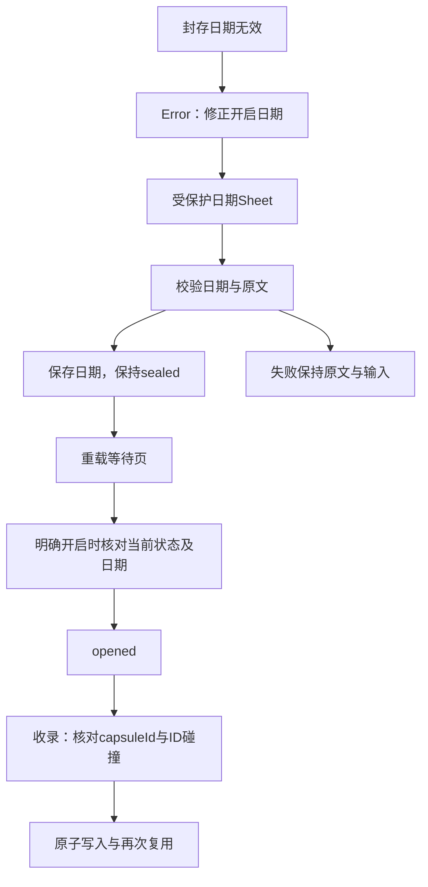

# 胶囊日期、当前状态与收录关联

最终检查点已通过：341项有名检查、228次全页观察、1696条观察控件、51次条件重定向，0次脚本错误、0个未绑定候选；HTTP114页／37共享资源与当前源码一致。114页仍0页最终验收，本结果仅覆盖声明范围。

## 实际问题与修复

17条日期／关联基线仅1条正常幂等通过，15条恢复入口基线仅1条多集合入口通过，均0次脚本错误。错误momentId及默认ID碰撞会打开“无关时刻”，private胶囊新收录没有可见范围字段；封存开启日期无效时无修正入口。另5条提交前当前状态基线全部失败：未来／异常日期仍能从旧页面开启，正文／标题和openedAt被旧快照覆盖，提醒开关也写回旧日期／正文。

Capsules复用既有Dates、put与Preferences.transaction；开启、提醒、收录均读取当前胶囊。开启重新核对sealed、有效日期与约定时间，已经opened只导航不二次写入；提醒只改变当前对象的reminder。收录要求当前opened，核对时刻的capsuleId，保留无关时刻；默认ID有碰撞时使用新ID，已存在本胶囊时刻则复用。新时刻标记published并继承private／shared；引用丢失或错误后明确收录可以重新建立正确关联，使用既有事务保持失败回滚和幂等。

## 日期修正与界面

封存胶囊opening无法解析时使用共享Error，提供“修正开启日期”。只修改opening和updatedAt，保持sealed和原信件、照片、提醒；没有有效日期不能开启。共享Sheet使用Field／Button／protectSheet及保存Loading，允许今天或未来的有效日期。原文与打开编辑Sheet时不同，或源集合损坏／配额不足／模拟保存失败时不覆盖，输入保持；关闭可继续编辑或明确放弃。日期修正不自动开启，成功后重载当前封存页。

页内已有同集合恢复CTA时隐藏页后重复入口；其他受损集合的入口仍保留。恢复观察器在一个恢复过程仍收尾时不提前记下新提示；取消结束后重新观察，避免新集合提示被漏掉，同一个未改变的已取消集合不立即重弹。

## 验证范围与来源

声明40专项：17条日期／dirty／配额／竞争／来源损坏／收录关联／private／状态／五宽度，5条提交前外部变化，3条保存期间取消／继续编辑／输入锁定，15条恢复入口／键盘／多集合／外部恢复。320／360／390／414／430日期Sheet另模拟44px顶部、34px底部安全区，检查可达按钮、中心命中、滚动与边界；不等同真实设备键盘和安全区验收。

指定回归301项：时间业务109、共享192，合计声明341项。时间11页54初始控件、7项事务／dirty、20项布局；胶囊8、纪念日10、时刻9、纪念日日期恢复1。共享包括两类宠物／回忆册恢复50、时间集合恢复82、备份37、副本15、回忆册全局6、两条新用户连续流程。最后数量、报告SHA、源码与HTTP／运行观察以capsule-semantic-checkpoint.json为准；没有该检查点不能认定最终通过。此前598项属于上一阶段源码，不相加。

日期保存的延迟期间关闭确认原先仍会写入，新增三条实际基线均失败。现在关闭尝试立即取消本次待执行写入，确认期间不写入，继续编辑后需明确再次保存；提交期间锁定日期输入。三条修复专项已通过，修改后全部声明回归重新执行，旧338项检查点保留在capsule-before-pending-save-fix。

此前中断后进程句柄和系统进程均确认不存在，本地预览端口拒绝连接；恢复服务指向同一worktree。完成的81项时间与50项宠物／回忆册报告包含完全匹配的源码、全部结果及0错误，按已生成终态报告重新核验；元数据明确revalidated_bound_report和exit_code=null。其他未完成／无源码绑定报告重新执行并记录实际退出值；不把重核验当作新执行或虚构原进程退出码。

首次控制器替换多余括号引起加载语法错误，诊断保留capsule-semantic-syntax-diagnostic；修正后重新运行。首版32项通过记录保留capsule-before-current-action-fix；新增当前状态提交后，恢复弹层收尾竞争的失败保留capsule-before-recovery-prompt-fix，再修复观察器。纪念日旧观察器改为等待确切document请求完成，防止历史弹层load误被当作最终页面加载。

最终回归首次执行有一项在review.html测试准备导航超过4.5秒，尚未执行恢复操作，0次脚本错误；原失败报告保留capsule-final-navigation-timeout。该组单独设置15秒导航等待，控件观察仍4.5秒，重新执行全部46项并按终态记录结果：46/46通过、退出0。最终元数据将该报告按完整同源终态重核验标记revalidated_bound_report与exit_code=null；不把第一次组执行的失败退出改写为成功。

上阶段指定报告及被覆盖图片的原字节保存在evidence/history/pre-capsule-semantics-13d559c，各自保留原源码来源。

## 继续工作

其他日期字段与状态语义、编辑原文竞争、失效引用和关系变化仍需逐页终验。旧已关联时刻后续自行改共享范围、来源可见范围后续变化及衍生链的共享过滤尚未在本阶段完整核对；此处只证明新收录继承private及当前操作正确。跨窗口即时显示刷新和编辑保存竞争也继续开放。114页仍0页最终验收，目标保持执行。
