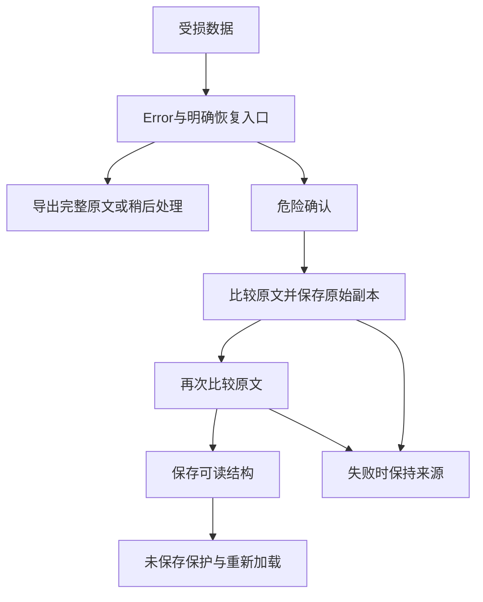

# 宠物与回忆册结构恢复

## 范围与规则

复用PrototypeUI集合恢复控制器，接入宠物和回忆册；受损根不再被领养／新建册覆盖。坏JSON、错误根、null条目、缺失／重复ID、无法读取的嵌套字段都保持原文，普通保存暂停。入口提供原文下载、稍后处理、重新检查和明确恢复；最终确认采用Danger，先保存完整原始副本，在保存副本前后比较原文。容量不足或竞争失败不替换来源。副本可从存储空间管理重新下载。

未领养的不存在／null／旧[]宠物均是合法空状态；新的账号注销写null，历史[]不弹恢复。未知宠物状态恢复为pending，并清除旧共同确认标记；未知册状态恢复为draft。无法读取的宠物数字以0表示，不发放奖励，不伪造共同确认。不合格来源引用使用sourceUnavailable遮蔽关联内容，明确换为有效来源后才解除。

## 页面与编辑

初次打开受损宠物或回忆册页面使用共享Error，显示恢复和返回首页入口，不静默跳成首次领养／空书架。正常表单遇到外部损坏，恢复时仍走未保存保护，“继续编辑”保留输入。共享备份使用同一health，受损时保留上一份完整备份。

旧回忆册未设置skipped时不额外补写空列表；阅读跳转测试等位置保存完成后再比较正文。旧书页未设置photos时继续使用其source照片，读取不强行插入空photos或supplements。文字补充的image／emoji允许null，保持既有保存合同；所有日期语义和孤立引用不属于此结构阶段的完整验收。

## 验证与证据来源

本阶段声明50项新增：24条实际原文下载／取消／写入拒绝／明确恢复，26条旧空值、注销后首次备份、未知状态、容量不足、竞争、dirty输入、副本重下载和320／360／390／414／430五宽度。24条恢复失败基线保存在evidence/baseline。

指定正常回归548项：宠物202、回忆册210、共享136。控件库存覆盖25宠物页151个初始控件、21回忆册页154个初始控件，隐藏状态／流程另计。最终通过与源码、报告SHA、HTTP字节和全页观察，以pet-book-recovery-checkpoint.json为准；没有该最终检查点不能认定通过。历史201／431项不累计为当前通过数。

第二次同源检查中回忆册153／154，其余均通过；实际阅读位置保存额外写入skipped空列表，诊断保存在book-read-normalization-diagnostic.json。已保留其缺省语义并重新冻结源码，早一版证据保留structured-before-read-field-fix。

初测发现真实兼容问题：旧照片来源被空photos遮蔽，未修改结构被额外空字段改变，文字补充null被错误判损坏；已修复生产逻辑并重跑原合同测试。两项旧工坊fixture缺少type和sourceIds，补齐合法数据后验证，不放宽生产校验。首次并行历史报告复制出现WinError32，改为共享组独占公共文件复制。

恢复会重新加载并可能导航到合法空态。初版观察器在页面切换前读取PrototypeUI或点击下载，遇到执行上下文销毁／导航等待；失败原始报告以navigation-observer-diagnostic保留。观察器等待确切document完成以及实际目标页面，不把观察器失败当作产品脚本错误。另unknown状态观察器旧原生历史导航误捕获及Response.finished残留任务诊断也保留。

修正可选字段前的报告保存在evidence/current/structured-before-optional-field-fix。上阶段指定报告和被覆盖图片的原字节保存在evidence/history/pre-pet-book-recovery-86362d5，各报告保留自己的源码来源。

## 仍开放

受损Error的内联恢复入口和页后全局恢复按钮目前重复，作为P2继续整理。全部日期／状态语义、孤立章节与来源、全部跨窗口编辑、安全区、动效和可访问性终验仍需推进。114页仍0页最终验收；此阶段不代表完整目标结束。

最终检查点已通过：598项全部通过且0次产品脚本错误，228次观察含1,698条控件节点、51次条件重定向；HTTP114页／37共享资源字节一致。此处观察另计，114页仍0页最终验收。
