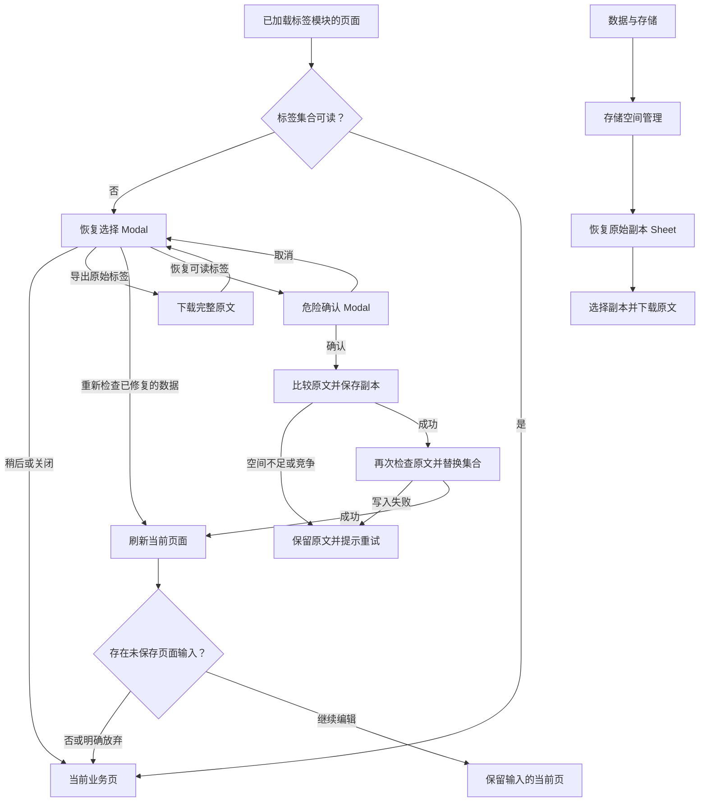

# 标签原文保护、恢复及副本

本文件301项属于此前源码，指定报告／图片保存在evidence/history/pre-time-collection-recovery-497a5dc。本阶段标签37项已同源重跑；最新431项的范围与边界见[时刻／纪念日／胶囊恢复实施记录](TIME_COLLECTION_RECOVERY_IMPLEMENTATION.md)。

## 问题与修复

16项失败基线包含8种损坏 × 标签设置／数据与存储入口。标签页把解析失败和真实缺失都当作未初始化：坏JSON与错误根两次原文覆盖，null条目另有一次脚本错误。其他基线没有明确恢复操作。

现在由现有PrototypePreferences分析标签；仅在集合确实不存在且存储可访问时初始化默认值。打开损坏集合只生成可读视图，不自动替换原文。普通UI.write、事务、标签修改／删除全部经过已有存储保护；损坏时阻止标签及关联记录事务，提示先恢复。记录自己的标签文字和私密过滤沿用原规则。

| 损坏 | 可读视图及恢复结果 |
| --- | --- |
| 坏JSON／错误根 | 无可读已存标签；完整原文仍保留，确认后可从空集合及记录标签继续 |
| null／非对象／缺失ID／无效名称 | 暂不展示无法标识的条目，原文在副本中保留 |
| 重复ID／忽略首尾空格及大小写后的重复名称 | 保留第一条可读标签，其他条目仍在原文副本 |
| 范围无效 | 保留名称及ID，可读范围为“我的标签”；不会擅自改为共同可见 |
| 真实缺失／合法空数组 | 缺失初始化默认值，空数组保持为空；记录中已有标签仍可查看，不产生恢复副本 |

恢复复用共享Button、Modal、Danger确认、Toast及现有页面／Sheet输入保护。原文可以先直接下载；确认后再比较当前原文，先写 `dujia-prototype-tag-recovery-*` 副本，再比较原文，最后替换。副本或替换失败保留原文；竞争时不覆盖其他页面新内容。替换失败留下的副本不删除，重试可能保留多个相同原文副本。

资料、记录、作品损坏先由原恢复接口处理，再处理标签；联合损坏实际验证顺序为资料→记录→作品→标签。恢复后的刷新仍遵守个人资料dirty保护；正在编辑的标签保存被阻止时保留输入，可以继续编辑或明确放弃，再恢复与重新保存。

已有“数据与存储→存储空间管理→查看恢复原始副本”增加标签副本识别及描述，可再次实际下载原文。清理缓存保留标签副本，明确注销本地账号清除副本；普通导出及共同备份不把副本原文打包进去。

## 当前阶段证据

- 标签16项损坏操作及21项异常／dirty／顺序／副本／五宽度，共37项；实际原文下载和副本再次下载比较文件内容。
- 设置12页81个初始控件、11项Sheet保护、10项宽度、14项正常与异常流程，共116项。
- 资料20、记录21、原副本15、工坊恢复44、工坊流程/状态11、工坊Error/Empty30、外部恢复3、取消生成3、八模块真实新用户连续流程1，共148项声明回归。
- 本阶段总计301项，不与旧阶段重复累计。最终源码、各报告字节哈希与HTTP114页／37资源核对见 `evidence/current/tag-recovery-checkpoint.json`。
- 114页空／有数据共228次观察，1,696条控件节点和51次条件重定向。观察不能代替所有控件及动态路径执行。

五宽度320、360、390、414、430px设置34px安全区，恢复选择及最终确认按钮检查屏内范围、44px热区、实际中心命中；恢复按钮Enter打开，Escape关闭后焦点恢复。320px截图已人工查看。软键盘、所有长标签视觉和Android原生事件不由这些浏览器模拟证明。

此前206项及被覆盖的指定报告／图片保存在 `evidence/history/pre-tag-recovery-fe89696`，各文件保留原来源；其他历史报告不作为本阶段通过依据。`tag-recovery-initial-state-results.json`为最初19项；缓存专项首次使用不存在的clear选择器，20/21诊断保存在`tag-recovery-cache-selector-diagnostic.json`，改用实际cache和“确认清理”控件后重新验证。这是观察器错误，没有据此修改产品行为。

## 开放问题与下一步

6类集合36项只读损坏诊断中，标签6项均保留原文且无脚本错误。其余仍有时刻2、纪念日2、胶囊2共6次null条目脚本错误；回忆册一次原文变化为保存阅读位置，null仍保留，不能当作丢失数据。其他集合坏JSON未报错也不证明保存安全，继续补齐原文保护、写入失败与明确恢复。

标签字段更广语义、记录引用与跨窗口编辑竞争、全部局部组件、完整动态状态／视觉／访问性／动效仍需继续。114页0页最终验收，I-01～I-07保持开放，完整目标继续执行。
