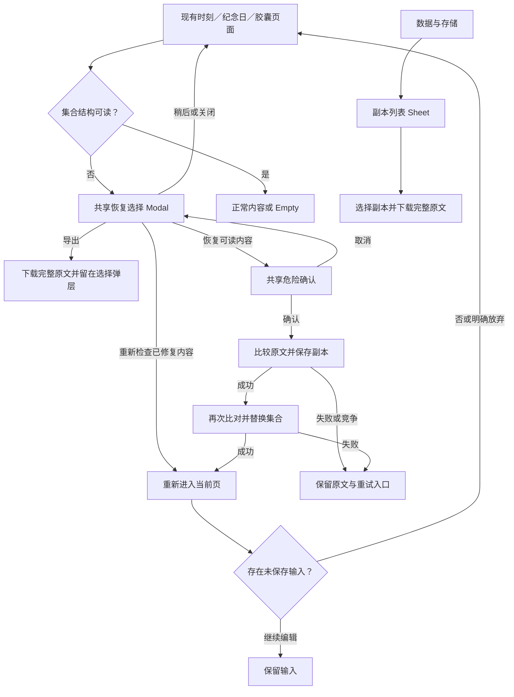

# 时刻、纪念日和胶囊的结构恢复

## 实际问题及修复

36项损坏基线（3类 × 6种损坏 × 2入口）全部失败，包含6次null条目脚本错误。旧read将坏JSON回退为无数据，普通保存可能覆盖原文；各业务遍历又直接访问null的属性。现在三类集合在原PrototypeUI读写层共用分析与恢复控制器，所有既有调用继续使用原key。没有新增框架、API或页面。

读取仅提供可读视图，不写回原文。受损集合的普通保存、删除和事务写入被阻止；Capsule收录事务仍检查所有写入键，失败不留下半完成结果。真正缺失继续原fallback，合法空集合不产生副本或默认内容。

| 条件 | 可读视图及明确恢复 |
| --- | --- |
| 坏JSON／错误根 | 无可读条目，原文保持；用户明确确认后从空集合继续 |
| null／非对象／缺失或重复ID | 保留第一条有稳定ID的可读条目，无法标识的内容在原始副本中 |
| 无法读取的名称、正文、日期或引用字段 | 保留ID，损坏文字为空；不会编造正文或日期 |
| 无法读取的图片或时间 | 图片置空、无效时间不参与排序；原始字段完整保留 |
| 时刻关联引用／回应损坏 | 保留可读字符串引用及有效回应，重复回应ID保留第一条 |
| 提醒或重复设置结构损坏 | 无法读取的开关关闭，无效提醒间隔暂停提醒；已有布尔和旧字符串重复形式保留 |
| 可见范围无效 | 恢复为仅自己可见，不扩大共同可见范围 |
| 胶囊状态无法读取 | 恢复为草稿，不自动开启或伪造结果 |

原文可直接下载。明确Danger确认之后两次比较当前原文：先保存以集合key加`-recovery-*`命名的完整副本，再次检查，再替换。副本空间不足不替换；替换失败保留原文及已保存副本。竞争时不覆盖其他页面新内容；重试可能保留多份相同原文副本，不清除已保留副本。

共享副本列表识别三类内容，并显示各类完整原始内容说明。用户沿现有“数据与存储→存储空间管理→查看恢复原始副本”再次下载原文。

## 状态、返回及输入

三类详情缺失状态统一采用共享Error／Empty。集合受损提示“数据需要恢复”；真正缺失提示“已经不在了”并返回各自列表。损坏CTA打开恢复，外部已修复时重新读取当前页；恢复刷新仍遵守页面dirty保护。日期字段恢复为空的纪念日保留ID和名称，详情提供“编辑纪念日”，实际选日期和保存已验证。

三类集合自动发现顺序为时刻→纪念日→胶囊；资料、记录、作品、标签优先沿其已有恢复处理。手动指定集合仍可请求相应恢复，恢复控制器一次只处理一个选择弹层。

回归复现手动恢复与胶囊列表异步读取交叠时，在用户关闭后再次自动弹出同一恢复。现在进入手动恢复时也记录该原文提示签名，后续同一原文读取不重复打开。不同原文仍能重新提示，恢复按钮仍可操作。该失败保留在`time-collection-manual-prompt-diagnostic.json`。

## 本阶段证据

当前431项有名检查全部通过（113新增＋170业务＋148共享）。228次观察包含1,698条控件节点、51次条件重定向、0次脚本错误和0个未绑定控件；36项损坏诊断无脚本错误，18项时间集合观察保持原文。其他集合1次回忆册阅读位置正常写入单独记录。

本批检查点为`evidence/current/time-recovery-checkpoint.json`，每份报告有源码和报告字节来源，HTTP114页／37资源与工作文件一致。

- 新增范围113项：36损坏恢复、46配额／竞争／事务／输入／副本／外部重查／不可用／五宽度／三类顺序、30详情Error／Empty、1纪念日日期恢复后编辑保存。
- 业务回归170项：时刻46个初始控件、9项隐藏、5项布局、9项流程／状态；时间54个控件、7项事务／失败、20项布局、18项流程／状态；两条真实注册用户连续流程。包含两处此前新增的共同提醒入口。
- 共享回归148项：标签37、资料20、记录21、作品44、副本15、设置Sheet保护11。旧阶段301项不相加，也不声称其全部原范围已在当前源重跑。
- 全114页空／有数据228次观察及6类集合36项损坏诊断分别记录；观察不能代替每条控件操作或全部状态验收。

恢复选择与最终确认在320、360、390、414、430px设置34px安全区，检查按钮屏内范围、44px热区、实际中心命中、Enter打开与Escape关闭的焦点。详情状态另检查30种组合。截图和数量以最终检查点为准；实际软键盘及Android原生事件不由这些浏览器模拟证明。

此前301项及指定报告／图片保存在`evidence/history/pre-time-collection-recovery-497a5dc`。共享结构第一版和缺失状态修复前报告在`time-collection-before-state-fix`；手动重复提示修复前报告在`time-recovery-before-manual-prompt-fix`，均保留各自源码，不计为最终通过。

两次观察器问题单列：联合顺序初测错误地要求每一步刷新后无Modal，实际上下一集合恢复Modal应存在，记录于`time-collection-order-observer-diagnostic.json`；旧时刻控件契约漏记此前新增的“共同提醒”，fresh inventory在输出新结果前中止，记录于`time-moment-contract-diagnostic.json`，补契约后实际执行两个入口。没有把旧报告当作本版结果。

## 已复现的下一阶段备份问题

audit_backup_with_damaged_time.py实际执行手动备份及自动备份：已有完整共享备份包含1条时刻；时刻原文损坏后，两种操作都把它替换为时刻0条的不完整快照。损坏原文仍保持，问题是上一份完整备份被覆盖。两个隔离上下文的同源结果见backup-damaged-time-observations.json，不计入431项通过检查。列为I-03/P1，下一阶段先保护完整备份。

## 开放范围

本批结构分析不证明全部字段语义正确：完整日期合法性、状态与时间一致性、失效来源引用、跨窗口编辑竞争，以及损坏日期的封存胶囊修正入口仍需继续。宠物和回忆册根／嵌套结构恢复尚未补齐，不能以只读诊断未报错认定安全。

页面关系和已声明主要流程有阶段证据；全部局部组件、完整动态条件、长文本／键盘／安全区／访问性／动效终验仍开放。114页0页最终验收，I-01～I-07保持开放，目标继续。
